# Entity-Relationship Diagram (ERD)

This ERD shows primary keys (PK), foreign keys (FK), cardinality and junction tables. It is
generated from the final schema (see `docs/database/README.md`).

```mermaid
erDiagram
    ORGANIZATIONS ||--o{ ORGANIZATION_MEMBERS : has
    ORGANIZATIONS ||--o{ COMPANIES : has
    ORGANIZATIONS ||--o{ CONTACTS : has
    ORGANIZATIONS ||--o{ ROLES : has
    ORGANIZATIONS ||--o{ PIPELINES : has
    ORGANIZATIONS ||--o{ CAMPAIGNS : has
    ORGANIZATIONS ||--o{ TASKS : has
    ORGANIZATIONS ||--o{ SERVICES : has
    ORGANIZATIONS ||--o{ INVOICES : has
    ORGANIZATIONS ||--o{ NOTIFICATIONS : has
    ORGANIZATIONS ||--o{ INTEGRATIONS : has

    PROFILES ||--o{ ORGANIZATION_MEMBERS : belongs
    PROFILES ||--o{ TASKS : assigned
    PROFILES ||--o{ AUDIT_LOGS : acts
    PROFILES ||--o{ NOTIFICATIONS : receives

    ROLES ||--o{ ORGANIZATION_MEMBERS : assigned
    ROLES ||--o{ ROLE_PERMISSIONS : has
    PERMISSIONS ||--o{ ROLE_PERMISSIONS : granted

    COMPANIES ||--o{ CONTACTS : employs
    COMPANIES ||--o{ DEALS : has
    COMPANIES ||--o{ LEAD_STATUS_HISTORY : tracked
    COMPANIES ||--o{ CLIENT_SERVICES : buys
    COMPANIES ||--o{ CONTRACTS : signs
    COMPANIES ||--o{ INVOICES : billed
    COMPANIES ||--o{ CLIENT_REQUIREMENTS : defines

    LEAD_SOURCES ||--o{ COMPANIES : originated
    LEAD_STATUSES ||--o{ COMPANIES : classifies
    LEAD_TAGS ||--o{ LEAD_TAG_ASSIGNMENTS : tagged

    PIPELINES ||--o{ PIPELINE_STAGES : orders
    PIPELINE_STAGES ||--o{ DEALS : contains
    DEALS ||--o{ DEAL_STAGE_HISTORY : transitions
    DEALS ||--o{ PROPOSALS : generates

    PROPOSALS ||--o{ PROPOSAL_ITEMS : line_items
    CONTRACTS ||--o{ CONTRACT_ITEMS : items
    SERVICES ||--o{ CLIENT_SERVICES : delivered

    CAMPAIGNS ||--o{ CAMPAIGN_CHANNELS : configures
    CAMPAIGNS ||--o{ CAMPAIGN_STEPS : sequences
    CAMPAIGNS ||--o{ CAMPAIGN_ENROLLMENTS : enrolls
    CAMPAIGN_STEPS ||--o{ EMAIL_MESSAGES : produces
    CONTACTS ||--o{ CAMPAIGN_ENROLLMENTS : enrolled
    CONTACTS ||--o{ EMAIL_MESSAGES : receives
    CONTACTS ||--o{ CONTACT_METHODS : channels
    EMAIL_TEMPLATES ||--o{ CAMPAIGN_STEPS : reused
    EMAIL_MESSAGES ||--o{ EMAIL_EVENTS : tracked
    EMAIL_ACCOUNTS ||--o{ EMAIL_MESSAGES : sends

    CONTACTS ||--o{ SUPPRESSION_LIST : suppressed

    MEETINGS ||--o{ MEETING_ATTENDEES : attendees
    COMPANIES ||--o{ MEETINGS : hosted
    DEALS ||--o{ MEETINGS : discussed

    NOTES }o--|| COMPANIES : noteable
    NOTES }o--|| CONTACTS : noteable
    NOTES }o--|| DEALS : noteable

    INVOICES ||--o{ INVOICE_ITEMS : items
    INVOICES ||--o{ PAYMENTS : allocated
```

## Notes

- Every business table carries `organization_id` (omitted above for readability).
- `lead_tag_assignments` and `meeting_attendees` are junction tables with a CHECK constraint
  enforcing exactly one target.
- `notes` uses a documented generic `noteable_type/noteable_id` reference (company/contact/deal).
